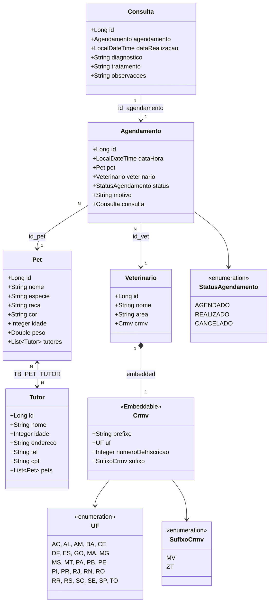
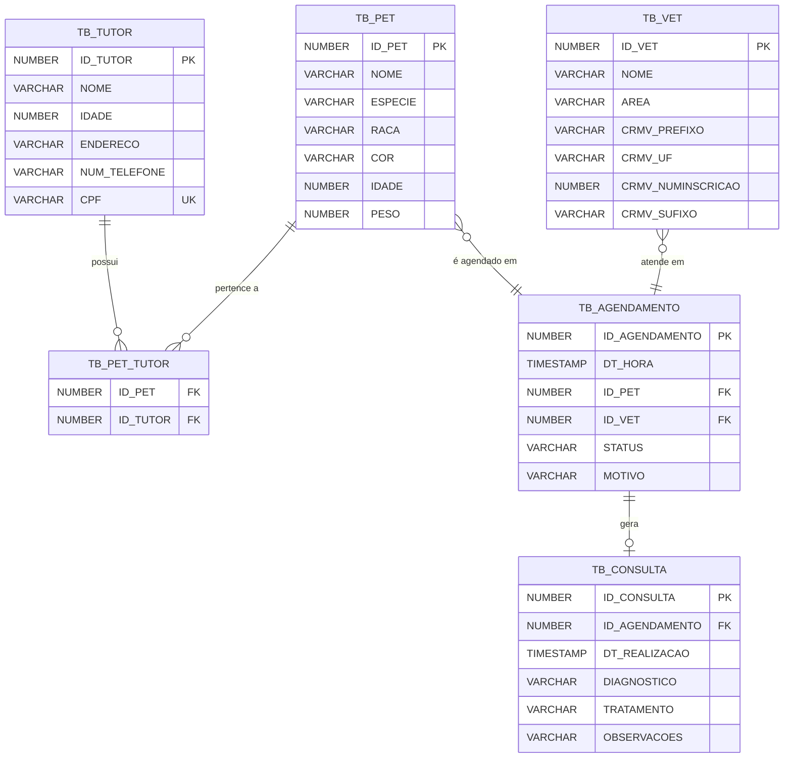

# 🐾 Clyvo — Sistema de Gestão Clínica Veterinária

Aplicação desenvolvida com Java e Spring Boot para gerenciamento de clínicas veterinárias.
O sistema permite cadastrar tutores, pets e veterinários, realizar agendamentos de consultas e registrar o histórico clínico dos animais.

Ele oferece duas formas de uso:

- **API RESTful** protegida por **JWT**, documentada com Swagger e com links **HATEOAS** nas respostas.
- **Interface web** (Thymeleaf) em `/web`, com login por formulário e menu de acordo com o perfil do usuário.

---

## 👥 Equipe - 2TDSPO
--------------------------------
|         Nome        |   RM   |
|---------------------|--------|
| Bruno A Zanateli    | 563736 |
| Christian S Freitas | 566098 |
| Pedro P Biasolli    | 562521 |
| Rodrigo Tiezzi      | 562975 |
| Maheus E Souza      | 562532 |
--------------------------------
---

## 🛠️ Tecnologias Utilizadas

| Tecnologia | Versão / Detalhe |
|------------|------------------|
| Java | 21 |
| Spring Boot | 4.0.6 |
| Spring Data JPA | gerenciado pelo Spring Boot |
| Spring Security + JWT (jjwt) | jjwt 0.11.5 |
| Spring HATEOAS | gerenciado pelo Spring Boot |
| Thymeleaf | gerenciado pelo Spring Boot |
| Oracle Database | 19c (FIAP) / XE 21 (Docker) |
| Flyway | migrations do banco (`flyway-database-oracle`) |
| SpringDoc OpenAPI (Swagger) | 3.0.0 |
| Bean Validation | gerenciado pelo Spring Boot |
| Lombok | gerenciado pelo Spring Boot |
| Maven | 3.9.15 (via Maven Wrapper) |
| Docker / Docker Compose | build multi-stage, usuário sem privilégios |

---

## 🏗️ Arquitetura

O projeto segue a arquitetura em camadas:

```
Controller → Service → Repository → Database (Oracle)
```

```
challengeClyvo/src/main/
├── java/br/com/fiap/challengeClyvo/
│   ├── controllers/       # Endpoints REST (e controllers/web para as telas Thymeleaf)
│   ├── services/          # Regras de negócio e transações
│   ├── repository/        # Acesso ao banco de dados (Spring Data JPA)
│   ├── entity/            # Entidades JPA
│   ├── dto/               # DTOs de request e response
│   ├── mapper/            # Conversão entre entidades e DTOs
│   ├── assemblers/        # Links HATEOAS das respostas
│   ├── enums/             # Enumerações (StatusAgendamento, UF)
│   ├── security/          # JWT, filtro de autenticação e tratamento de 401/403
│   ├── config/            # Segurança (duas cadeias) e OpenAPI
│   └── exceptions/        # Tratamento global de erros
└── resources/
    ├── db/migration/      # Scripts Flyway (V1__create_tables.sql)
    ├── templates/         # Páginas Thymeleaf
    └── static/web/        # CSS e JavaScript das telas
```

---

## 🔐 Segurança e Perfis de Acesso

A aplicação tem duas cadeias de segurança independentes:

| Cadeia | Rotas | Autenticação |
|--------|-------|--------------|
| API REST | `/tutor`, `/pet`, `/veterinario`, `/agendamento`, `/consulta` | Token **JWT** (`Authorization: Bearer <token>`), sem sessão |
| Interface web | `/web/**` | Login por formulário + sessão, com CSRF ativo |

Existem dois perfis:

| Perfil | Tutores, Pets e Veterinários | Agendamentos e Consultas |
|--------|:---:|:---:|
| `ADMIN` | ✅ | ✅ |
| `VETERINARIO` | ❌ | ✅ |

Acesso sem permissão retorna **401** (sem token ou token inválido) ou **403** (perfil sem permissão) em JSON na API e redireciona para a tela de acesso negado na interface web.

### Como obter o token

```http
POST /auth/login
Content-Type: application/json

{
  "username": "seu_usuario",
  "password": "sua_senha"
}
```

Use o token retornado no cabeçalho `Authorization: Bearer <token>` das demais requisições. No Swagger, clique em **Authorize** e cole o token.

---

## 📊 Diagrama de Classes



---

## 🗄️ DER — Diagrama Entidade-Relacionamento

O esquema é criado e versionado pelo **Flyway** (`V1__create_tables.sql`). O Hibernate apenas valida o esquema (`ddl-auto=validate`).



---

## 🚀 Como Rodar o Projeto

### Pré-requisitos

- Java 21+
- Maven 3.x (ou use o `./mvnw` incluído no projeto)
- Acesso ao banco Oracle (FIAP), ou Docker para subir um Oracle local

### Configuração

As credenciais **não ficam no código**: o `application.properties` lê tudo de variáveis de ambiente. Defina as variáveis antes de executar:

| Variável | Obrigatória | Descrição | Padrão |
|----------|:---:|-----------|--------|
| `DB_URL` | não | URL JDBC do Oracle | `jdbc:oracle:thin:@oracle.fiap.com.br:1521:ORCL` |
| `DB_USERNAME` | **sim** | Usuário do banco (seu RM) | — |
| `DB_PASSWORD` | **sim** | Senha do banco | — |
| `JWT_SECRET` | **sim** | Chave usada para assinar os tokens JWT | — |
| `JWT_EXPIRATION_MS` | não | Validade do token em milissegundos | `3600000` (1 hora) |
| `ADMIN_USERNAME` / `ADMIN_PASSWORD` | não | Login do perfil `ADMIN` | valores de desenvolvimento |
| `VET_USERNAME` / `VET_PASSWORD` | não | Login do perfil `VETERINARIO` | valores de desenvolvimento |
| `PORT` | não | Porta do servidor | `8080` |

Exemplo (Linux/macOS):

```bash
export DB_USERNAME=SEU_RM
export DB_PASSWORD=SUA_SENHA
export JWT_SECRET=uma-chave-longa-e-aleatoria
```

No Windows (PowerShell), use `$env:DB_USERNAME="SEU_RM"` e assim por diante.

> ⚠️ **Nunca** coloque usuário, senha ou o `JWT_SECRET` direto no `application.properties` nem faça commit deles. Em produção, troque também os logins padrão de `ADMIN` e `VETERINARIO`.

### Executando

```bash
# Clone o repositório
git clone https://github.com/XXXXXX/challengeClyvo.git

# Entre na pasta do projeto
cd challengeClyvo/challengeClyvo

# Execute com Maven
./mvnw spring-boot:run
```

Ao iniciar, o Flyway cria as tabelas automaticamente.

A aplicação estará disponível em:

- Local: `http://localhost:8080` (interface web em `http://localhost:8080/web`)
- Produção: `https://java-challenge-fiap-2026.onrender.com/web/login`

### Executando com Docker

O `docker-compose.yml` sobe a API junto com um Oracle XE local. A conexão com o banco já está configurada no compose, mas o `JWT_SECRET` é obrigatório e **precisa ser adicionado** à seção `environment` do serviço `api`:

```yaml
    environment:
      JWT_SECRET: uma-chave-longa-e-aleatoria
      # ...demais variáveis já existentes
```

Depois, suba os containers:

```bash
cd challengeClyvo
docker compose up --build
```

A API ficará em `http://localhost:8080`. O container roda com um usuário sem privilégios administrativos.

> ⚠️ As credenciais do Oracle no `docker-compose.yml` servem apenas para uso local. Não as reutilize em outros ambientes.

---

## 🖥️ Interface Web

A interface fica em `/web` e o menu muda conforme o perfil do usuário logado.

| Tela | Rota | Perfis |
|------|------|--------|
| Login | `/web/login` | todos |
| Início | `/web` | autenticados |
| Tutores | `/web/tutor` | `ADMIN` |
| Pets | `/web/pet` | `ADMIN` |
| Veterinários | `/web/veterinario` | `ADMIN` |
| Agendamentos | `/web/agendamento` | `ADMIN`, `VETERINARIO` |
| Consultas | `/web/consulta` | `ADMIN`, `VETERINARIO` |

Recursos das telas:

- Listas com paginação e linhas expansíveis
- Mensagens de sucesso após cadastrar, editar, excluir ou cancelar
- Estado de lista vazia com atalho para o primeiro cadastro
- Vínculo de tutor ao pet por seleção
- Proteção contra envio duplo de formulário
- Páginas de erro e de acesso negado amigáveis

---

## 📖 Documentação da API

Com a aplicação rodando, acesse o Swagger UI:

```
http://localhost:8080/swagger-ui.html
```

A especificação OpenAPI em JSON fica em `http://localhost:8080/api-docs`. O Swagger permite autenticar com o token JWT pelo botão **Authorize**.

---

## 📋 Endpoints

Todos os endpoints (exceto `/auth/login`) exigem o token JWT. As listagens são paginadas (`page`, `size`, `sort`).

### 🔑 Autenticação `/auth`

| Método | Endpoint | Descrição |
|--------|----------|-----------|
| POST | `/auth/login` | Autentica e retorna o token JWT |

### 👤 Tutor `/tutor` — perfil `ADMIN`

| Método | Endpoint | Descrição |
|--------|----------|-----------|
| GET | `/tutor` | Lista todos os tutores |
| GET | `/tutor/{id}` | Busca tutor por ID |
| GET | `/tutor/nome/{nome}` | Busca tutor por nome |
| GET | `/tutor/cpf/{cpf}` | Busca tutor por CPF |
| POST | `/tutor` | Cadastra novo tutor |
| PUT | `/tutor/{id}` | Atualiza tutor |
| DELETE | `/tutor/{id}` | Remove tutor |

### 🐾 Pet `/pet` — perfil `ADMIN`

| Método | Endpoint | Descrição |
|--------|----------|-----------|
| GET | `/pet` | Lista todos os pets |
| GET | `/pet/{id}` | Busca pet por ID |
| GET | `/pet/nome/{nome}` | Busca pet por nome (parcial, sem diferenciar maiúsculas) |
| GET | `/pet/especie/{especie}` | Busca pet por espécie |
| GET | `/pet/tutor/{idTutor}` | Lista pets de um tutor |
| POST | `/pet` | Cadastra novo pet |
| POST | `/pet/{idPet}/tutor/{idTutor}` | Vincula tutor ao pet |
| PUT | `/pet/{id}` | Atualiza pet |
| DELETE | `/pet/{id}` | Remove pet |
| DELETE | `/pet/{idPet}/tutor/{idTutor}` | Desvincula tutor do pet |

### 🩺 Veterinário `/veterinario` — perfil `ADMIN`

| Método | Endpoint | Descrição |
|--------|----------|-----------|
| GET | `/veterinario` | Lista todos os veterinários |
| GET | `/veterinario/{id}` | Busca veterinário por ID |
| GET | `/veterinario/area/{area}` | Busca por área de atuação |
| GET | `/veterinario/crmv/{numeroDeInscricao}` | Busca por número CRMV |
| GET | `/veterinario/uf/{uf}` | Busca por UF do CRMV |
| POST | `/veterinario` | Cadastra novo veterinário |
| PUT | `/veterinario/{id}` | Atualiza veterinário |
| DELETE | `/veterinario/{id}` | Remove veterinário |

### 📅 Agendamento `/agendamento` — perfis `ADMIN` e `VETERINARIO`

| Método | Endpoint | Descrição |
|--------|----------|-----------|
| GET | `/agendamento` | Lista todos os agendamentos |
| GET | `/agendamento/{id}` | Busca agendamento por ID |
| GET | `/agendamento/status/{status}` | Busca por status (AGENDADO, REALIZADO, CANCELADO) |
| GET | `/agendamento/veterinario/{idVet}` | Lista agendamentos de um veterinário |
| GET | `/agendamento/pet/{idPet}` | Lista agendamentos de um pet |
| POST | `/agendamento` | Cria novo agendamento |
| PATCH | `/agendamento/{id}/cancelar` | Cancela um agendamento |

### 🏥 Consulta `/consulta` — perfis `ADMIN` e `VETERINARIO`

| Método | Endpoint | Descrição |
|--------|----------|-----------|
| GET | `/consulta` | Lista todas as consultas |
| GET | `/consulta/{id}` | Busca consulta por ID |
| GET | `/consulta/pet/{idPet}` | Lista consultas de um pet |
| GET | `/consulta/veterinario/{idVet}` | Lista consultas de um veterinário |
| POST | `/consulta/agendamento/{idAgendamento}` | Realiza consulta de um agendamento |
| PATCH | `/consulta/{id}/observacoes` | Atualiza observações da consulta |

---

## 📏 Regras de Negócio

- Não é possível cadastrar dois tutores com o mesmo CPF.
- Não é possível cadastrar dois veterinários com o mesmo CRMV (UF + número de inscrição).
- Um veterinário não pode ter dois agendamentos no mesmo horário. Agendamentos **cancelados** não bloqueiam o horário.
- O agendamento deve ser feito para uma data futura.
- Não é possível cancelar um agendamento cuja consulta já foi realizada.
- Não é possível realizar a consulta de um agendamento cancelado.
- Cada agendamento pode ter apenas uma consulta realizada.
- Um tutor não pode ser vinculado duas vezes ao mesmo pet, e só é possível desvincular um tutor que esteja vinculado.
- Um pet pode ter no máximo **2 tutores**.
- Registros vinculados a outros dados (por exemplo, um pet com agendamentos) não podem ser excluídos.

Erros de regra de negócio retornam **400**, recurso inexistente **404**, violação de integridade **409** e erros inesperados **500**, sempre em JSON padronizado.

---

## 📁 Estrutura de Documentação

```
docs/
├── APIClyvoRequicoes.postman_collection.json   # Coleção Postman com todos os endpoints
├── Diagrama de Classes.mermaid                  # Diagrama de Classes
└── der.mermaid                                  # Diagrama Entidade-Relacionamento
```

---

## ✅ Requisitos Atendidos

- [x] Persistência de dados com Oracle
- [x] Versionamento do banco com Flyway
- [x] Relacionamentos JPA (`@ManyToMany`, `@ManyToOne`, `@OneToOne`, `@Embeddable`)
- [x] Bean Validation (`@NotNull`, `@NotBlank`, `@Future`, `@Positive`, etc.)
- [x] Paginação e ordenação de resultados
- [x] Busca com parâmetros
- [x] Tratamento global de exceções
- [x] Autenticação e autorização com Spring Security e JWT, com perfis
- [x] HATEOAS nas respostas da API
- [x] Interface web com Thymeleaf
- [x] Documentação com Swagger (SpringDoc)
- [x] Spring JPA Query Methods e JPQL
- [x] Regras de negócio além do CRUD
- [x] Exportação de endpoints (Postman)
- [x] Containerização com Docker e Docker Compose
